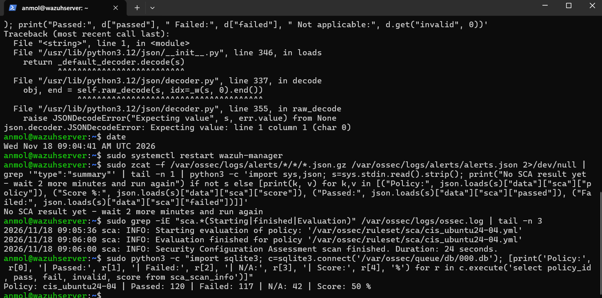
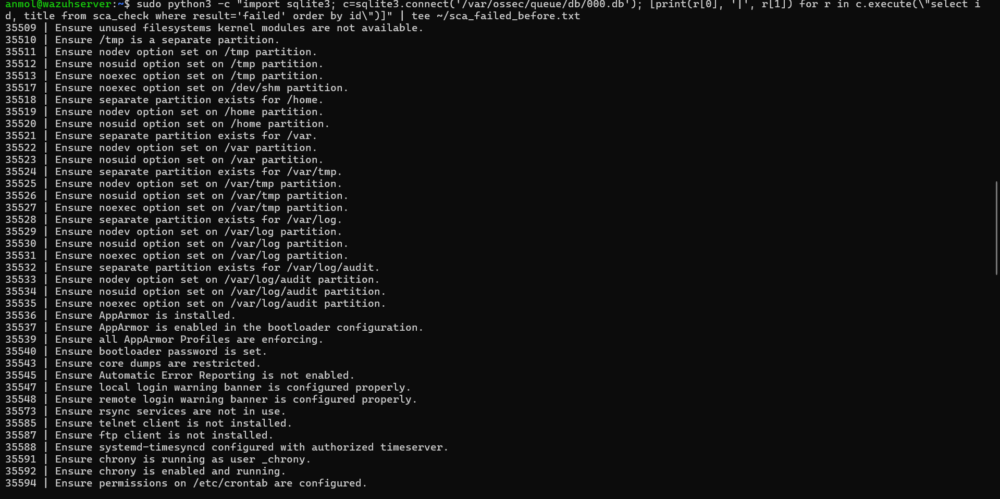
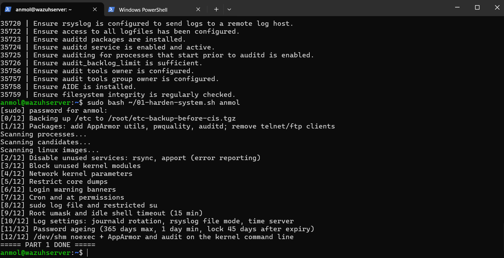
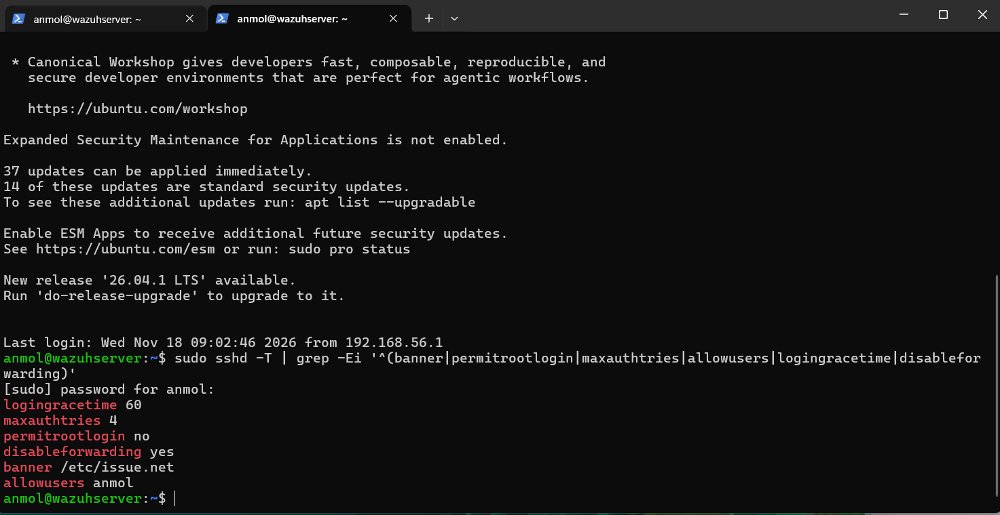
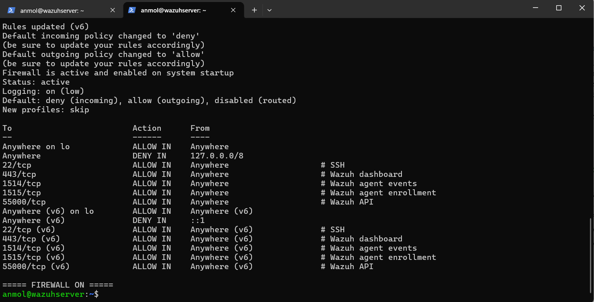
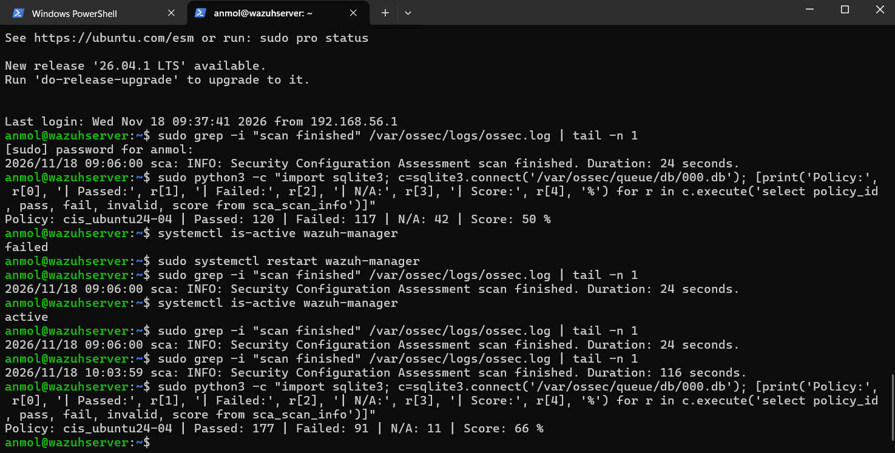

# Wazuh CIS Hardening Lab: 50% → 66% in One Session

Hardening an Ubuntu Server 24.04 host against the **CIS Benchmark**, measured with **Wazuh Security Configuration Assessment (SCA)**. Three scripts fixed 57 checks and raised the compliance score by 16 points, without locking myself out of the server.

Part 3 of my Wazuh home-lab series:
[Part 1: brute-force detection](https://github.com/AnmolNisar/wazuh-bruteforce-detection-lab) ·
[Part 2: ransomware detection with FIM](https://github.com/AnmolNisar/wazuh-fim-ransomware-detection)

## Results

| | Before | After | Change |
|---|---|---|---|
| **CIS score** | 50% | **66%** | **+16 points** |
| Checks passed | 120 | 177 | +57 |
| Checks failed | 117 | 91 | −26 |
| Not applicable | 42 | 11 | −31 |

Why did "failed" drop by only 26 when 57 more checks passed? Installing **auditd** and the **AppArmor** tools made 31 checks that could not run before become applicable. Some of those now pass, some still fail. The score counts only applicable checks.

## What this project shows

| Skill | How it's shown |
|---|---|
| Compliance assessment | Wazuh SCA scored the host against the CIS Ubuntu 24.04 policy (`cis_ubuntu24-04`) |
| Linux hardening | Kernel parameters, kernel modules, SSH, PAM/su, cron, logging, auditd, firewall |
| Risk-based remediation | Every fix judged for lock-out or breakage risk; risky items documented, not blindly applied |
| Change safety | `/etc` backup before changes, `sshd -t` config test with automatic rollback, firewall rules added before enabling |
| Measurement | Score read from the Wazuh database before and after, with evidence screenshots |

## Lab

Single VM in VirtualBox on Windows: Ubuntu Server 24.04.5 LTS, 8 GB RAM, Wazuh 4.14 all-in-one. The Wazuh manager assesses its own host.

## How to reproduce

**1. Get the baseline score** (after a scan has run):
```bash
sudo grep -i "scan finished" /var/ossec/logs/ossec.log | tail -n 1
sudo python3 -c "import sqlite3; c=sqlite3.connect('/var/ossec/queue/db/000.db'); [print('Policy:', r[0], '| Passed:', r[1], '| Failed:', r[2], '| N/A:', r[3], '| Score:', r[4], '%') for r in c.execute('select policy_id, pass, fail, invalid, score from sca_scan_info')]"
```

**2. List the failed checks:**
```bash
sudo python3 -c "import sqlite3; c=sqlite3.connect('/var/ossec/queue/db/000.db'); [print(r[0], '|', r[1]) for r in c.execute(\"select id, title from sca_check where result='failed' order by id\")]"
```

**3. Apply the hardening** (copy `scripts/` to the server first):
```bash
sudo bash scripts/01-harden-system.sh <your-user>
sudo bash scripts/02-harden-ssh.sh <your-user>   # then test a NEW ssh session before closing the old one
sudo bash scripts/03-firewall.sh
sudo reboot
```

**4. Rescan** with `sudo systemctl restart wazuh-manager`, wait for "scan finished", and read the score again.

## What the scripts change

### 01-harden-system.sh (12 steps)
| Area | Change | CIS checks |
|---|---|---|
| Packages | Install `apparmor-utils`, `libpam-pwquality`, `auditd`; remove telnet/ftp clients | AppArmor, pwquality, auditd, client removal |
| Services | Disable `rsync` and `apport` (automatic error reporting) | rsync, apport |
| Kernel modules | Block `dccp`, `tipc`, `rds`, `sctp` and unused filesystems | 4 network protocols + filesystems |
| Network sysctl | No ICMP/secure redirects, no source routing, reverse-path filtering, log martians, no IPv6 RAs | 7 network checks |
| Core dumps | `* hard core 0`, `fs.suid_dumpable = 0` | core dumps |
| Banners | Authorized-use warning in `/etc/issue` and `/etc/issue.net` | local + remote banner |
| Cron / at | Root-owned, `og-rwx` permissions, `cron.allow` and `at.allow` | 8 cron/at checks |
| sudo / su | sudo log file; `su` restricted to an empty `sugroup` | sudo log, su restriction |
| Shell | Root umask `0027`; 15-minute idle timeout (`TMOUT=900`) | umask, shell timeout |
| Logging & time | journald rotation, rsyslog file mode `0640`, timesyncd NTP servers | journald, rsyslog, timesyncd |
| Passwords | Max 365 days, min 1 day, lock 45 days after expiry | 3 ageing checks |
| Boot | `/dev/shm` `noexec,nosuid,nodev`; `apparmor=1 audit=1 audit_backlog_limit=8192` on the kernel command line | /dev/shm, AppArmor boot, audit boot |

### 02-harden-ssh.sh
`PermitRootLogin no`, `MaxAuthTries 4`, `LoginGraceTime 60`, `MaxStartups 10:30:60`, `ClientAliveInterval 15`, `DisableForwarding yes`, `AllowUsers`, strong MACs, a login banner, and `600` permissions. The config is validated with `sshd -t` and rolled back automatically if it fails. Password login stays on so the lab stays reachable.

### 03-firewall.sh
`ufw` with default deny incoming. Only SSH (22), the dashboard (443), agent events (1514), enrollment (1515) and the API (55000) are allowed. Loopback is explicitly allowed and spoofed loopback traffic denied. All rules are added **before** the firewall is turned on.

## What I deliberately did not change

| Check | Why I skipped it |
|---|---|
| Separate partitions for `/tmp`, `/home`, `/var`, `/var/log`, `/var/log/audit` (22 checks) | Needs a reinstall or repartition |
| Bootloader password | Risk of being stuck at the boot menu in a lab VM |
| PAM faillock, pwhistory, pwquality enforcement | A few mistyped passwords could lock me out of my only account |
| All AppArmor profiles in enforce mode | Could break Wazuh components without per-profile testing |
| AIDE file integrity | Wazuh FIM already covers this in my lab (Part 2) |
| nftables / iptables-only checks | CIS asks for **one** firewall tool; I chose ufw, so the alternatives stay "failed" |

In a production environment each of these would go through change management and testing rather than being skipped. The point is to make the trade-off visible.

## Lessons learned

- **Measure first.** A score and a list of failed checks turned "harden the server" into 117 concrete items.
- **Not every failed check should be fixed blindly.** Many were risky or needed downtime; documenting why matters as much as fixing.
- **Build in a rollback.** The `/etc` backup, the `sshd -t` test and keeping a second SSH session open meant no change could lock me out.
- **Scores move in surprising ways.** Installing tools made new checks applicable, which is why "failed" fell less than "passed" rose.
- **Hardening has side effects.** After the reboot the Wazuh manager failed to start in time; the fix is a systemd `Restart=on-failure` override so it retries on slow boots.

## Screenshots

**Before: 50% (120 passed, 117 failed)**



**Some of the failed checks**



**Part 1: system hardening, 12 steps**



**Part 2: SSH settings verified with sshd -T**



**Part 3: ufw firewall, default deny**



**After: 66% (177 passed, 91 failed)**



## Repo layout

```
scripts/   01-harden-system.sh, 02-harden-ssh.sh, 03-firewall.sh
docs/      screenshots
```

## License

MIT
